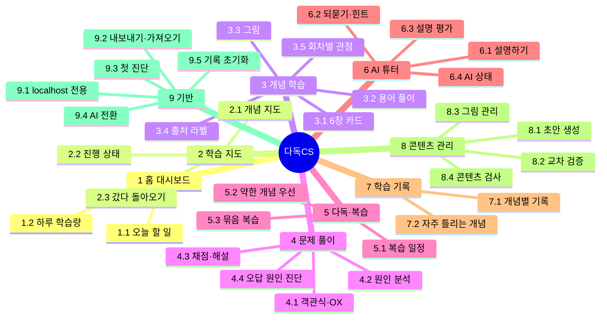
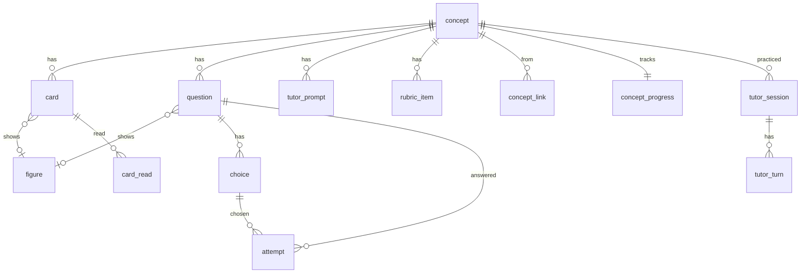

# 다독CS 기능명세서

> 내 프로젝트(Plan B·Trova·MOIT)에서 겪은 문제를 교재로, 같은 개념을 여러 관점으로 다시 읽고(다독) 문제와 AI 튜터로 빈틈을 채워 **백엔드 CS를 내 말로 설명**할 수 있게 되는 개인용 학습 웹 서비스.

## 1. 프로젝트 기본 정보

| 항목 | 내용 |
|---|---|
| 앱 이름 | 다독CS (레포 `dadok-cs`, 매니저 관리 이름 `backend-cs-tutor`) |
| 플랫폼 | 웹 — 내 PC 브라우저, 반응형. 서버는 localhost(127.0.0.1)에만 열림 |
| 사용자 | 나 혼자 (로그인 없음) |
| 기술 스택 | Spring Boot + React, PostgreSQL, Spring AI 2(AI 호출), Gradle wrapper. 버전은 구현 시작 시 공식 문서로 확인 |
| AI | 내 PC의 Codex CLI(구독) → 2026-12-01부터 Claude CLI(구독). Spring AI 2의 모델 인터페이스에 맞춘 자체 CLI 어댑터 |
| 비용 | 0원 (추가 결제·유료 API 없음) |
| 시간대·날짜 기준 | 한국 시간, **하루는 새벽 4시에 시작** |
| 완료 기준 | 아래 "성공 지표" 표 — 테스트·콘텐츠 검사·E2E·2주 사용 뒤 설명 점수 변화 |

### 사람 손이 필요한 일
| 일 | 언제 | 비고 |
|---|---|---|
| JDK 설치 | 개발 시작 전 | 이 PC에 없음. PC 전체 설치라 승인 필요 |
| PostgreSQL 설치 | 개발 시작 전 | 승인 필요. 테스트는 설치 없이 도는 내장형 PostgreSQL |
| 서비스 GitHub 레포 생성(비공개) | spec 확정 뒤 | 승인 필요 |
| Codex·Claude CLI 로그인 | 완료 | Codex는 2026-11-30까지 |
| 내 프로젝트 사례 카드 15장 사실 확인 | 콘텐츠 생성 뒤 | 원본 기록(포트폴리오·Trova 기록)과 대조 |

## 2. PRD

### 개요
같은 CS 개념을 쉬운 비유 → 동작 원리 → 심화 → 내 프로젝트 사례 → 새 상황 → 비교, 그리고 AI 튜터와 "내 말로 설명"까지 **7회차에 걸쳐 다르게 읽는다.** 문제는 점수가 아니라 빈틈을 찾는 도구이고, 틀린 이유에 맞는 설명으로 돌려보낸다. 설명·문제는 미리 만들어 다른 모델로 검증한 것만 보여 주고, 실시간 AI는 튜터 대화와 설명 평가에만 쓴다.

### 문제와 해결 방안
| 문제 | 해결 |
|---|---|
| 프로젝트에서 문제는 해결했지만 원리를 내 말로 설명하기 어렵다 | 내가 겪은 사례에서 출발해 원리까지 거슬러 올라간다 |
| 한 번 읽은 개념은 금방 잊힌다 | 7가지 관점으로, 간격을 두고 다시 읽는다 |
| 문제를 맞혀도 이해했는지 모른다 | 오답 보기마다 원인(6유형)을 미리 붙여 진단하고 맞는 카드로 돌려보낸다 |
| 외운 문장으로 답하게 된다 | AI 튜터가 모범답안 대신 질문으로 빈틈을 채우게 한다 |
| AI 설명이 틀리면 틀린 걸 반복해서 외운다 | 미리 생성 → 교차 검증 → 통과분만 노출. 일반론·실측·추정을 구분해 표시 |

### 타깃과 사용 시나리오
나 한 명 — 백엔드 프로젝트 경험은 있지만 CS 기초가 체계적이지 않고, 면접·기술 대화에서 원리를 자연스럽게 설명하고 싶다.
1. **아침 학습**: 대시보드의 오늘 할 일(약한 개념 → 복습 → 새 개념 → 문제 → 튜터)을 위에서부터 따라간다.
2. **막혔을 때**: GC를 읽다 "힙"이 낯설면 선행 개념으로 갔다가 "← GC로 돌아가기"로 돌아온다.
3. **사례 연결**: 인덱스 원리를 읽은 뒤 Trova ABBA 실험과 "운영 규모에선 효과 없던 이유"를 읽는다.
4. **문제 풀이**: "DB CPU 97%, 연결 대기 21개" 원인 분석 문제를 틀리면 "혼동"으로 진단되어 비교 카드로 간다.
5. **설명 연습**: "인덱스를 설명해 봐" → 튜터가 세 번 되묻고, 빠진 핵심 요소와 추정 점수를 남긴다.

### 성공 지표
| 기준 | 재는 방법 |
|---|---|
| 개념 15개가 선행 관계로 연결된 지도 | 지도 화면 테스트, 모든 개념에 선행·관련 1개 이상 |
| 개념마다 카드 6장 + 문제 5개 이상(원인 분석 1개 이상) + 체크리스트 + 그림 1개 이상 | 콘텐츠 검사(CI) |
| 노출 콘텐츠 100% 검증됨, 출처 라벨·캡처 캡션 누락 0 | 콘텐츠 검사(CI) |
| 하루 학습 흐름이 끊김 없이 이어짐 | E2E 테스트 |
| 복습 일정이 규칙대로(맞히면 늘고 틀리면 1일) | 단위 테스트 |
| 튜터가 모범답안을 그대로 주지 않음 | 튜터 응답 표본 20개 검토 |
| 2주 사용 뒤 같은 질문의 설명 점수 상승 | 학습 기록 화면(추정 표시) |

### 위험 요소
| 위험 | 대응 |
|---|---|
| AI가 만든 설명·문제가 틀림 | 다른 모델 교차 검증 + 사례 카드는 내가 확인 |
| AI 평가가 부정확 | 미리 검증한 체크리스트와 비교만, "추정" 표시, 정답률·반복 결과와 함께 판단 |
| Codex 종료(11/30) | CLI 어댑터 교체로 Claude 전환. 콘텐츠 초안은 11/30 전에 Codex로 먼저 |
| CLI 응답이 느림 | 실시간 호출은 튜터·평가만, 진행 표시, 90초 초과 시 나중에 평가 |
| 콘텐츠 작업량(카드 90장) | MVP 15개로 제한, 생성·검증 파이프라인 |

### 범위
- **포함**: 학습 지도, 6장 카드(+튜터 = 7회차), 용어 풀이, 그림(코드 그림·실제 화면·문제 속 그림), 출처 라벨, 객관식·OX·원인 분석, 오답 진단·복습 일정, 학습 기록, 텍스트 AI 튜터, 콘텐츠 생성·검증·검사, 첫 진단, 기록 내보내기·가져오기·초기화, AI 전환
- **제외**: 빈칸·기술 선택·서술형 문제 자동 평가(튜터 평가만), 실전 모드, 음성, 면접 연습, 다중 사용자·로그인, 배포, 알림, 13개 커리큘럼 전체

### MVP 개념 15개
| 묶음 | 개념 |
|---|---|
| 기초 | ① 프로세스와 메모리 · ② 네트워크 왕복 지연 |
| 데이터베이스 | ③ 인덱스와 B-Tree · ④ 실행 계획과 Seq Scan · ⑤ N+1 · ⑥ 커넥션 풀과 대기 · ⑦ JDBC 배치 |
| 캐시·동시성 | ⑧ 캐시(Redis·메모리) · ⑨ 분산 락 · ⑩ 비동기 처리(CompletableFuture) |
| 메시지 | ⑭ Kafka와 메시지 큐 |
| JVM·서버 | ⑪ JVM 힙과 GC · ⑫ 스왑·OOM·CPU steal |
| 성능 측정 | ⑬ p95·처리량·부하 테스트 |
| AI 백엔드 | ⑮ Spring AI 2 (사례: 이 서비스 자체) |

## 3. 기능 트리

필수 기반 기능(아이디어 밖, 사용자 확인): 9.1~9.5.

## 4. 기능 상세

모든 화면 공통 — 가독성: 한 화면 한 단계, 문단 3~4줄, 핵심 문장 굵게, 처음 나오는 용어 풀이, 숫자는 표 + 조건, 코드·SQL 블록, 글자 크기 조절, 다크 모드, 읽던 위치 기억, 한글 줄바꿈. 권한·접근: localhost 전용, 로그인 없음(9.1) — 아래에서 따로 적지 않는다.

### 1. 홈 대시보드
- **R-1** 1.1 오늘 할 일 — 하루 학습 흐름을 한 목록과 진행 막대로 보여 준다
  - 비즈니스 규칙: 순서 = 약한 개념 → 복습 → 새 개념 → 문제 → 튜터 설명 1번. 하루 학습량(R-2)을 넘는 복습은 다음 날로(약한 개념 → 오래 밀린 개념 순). 하루는 새벽 4시 시작
  - 데이터: concept_progress(다음 복습일·상태), settings
  - 화면: 빈 상태 — 첫 실행이면 "첫 진단부터 해요"(R-31), 오늘 할 일을 다 하면 "오늘 끝! 다음 복습 n개는 내일"
  - 예외 상황: 검증된 콘텐츠가 없는 개념은 목록에서 빠짐
  - 확인 방법: 하루 학습 흐름 E2E 테스트(복습 → 새 개념 → 문제 → 튜터)
- **R-2** 1.2 하루 학습량 — 시간 또는 개념 수, 모드(다독형·문제형·균형)
  - 비즈니스 규칙: 기본 60분·균형(새 개념 최대 2개). 다독형은 카드 위주, 문제형은 문제 위주
  - 데이터: settings
  - 확인 방법: 설정을 바꾸면 오늘 할 일 구성이 바뀌는 단위 테스트

### 2. 학습 지도
- **R-3** 2.1 개념 지도 — 7개 묶음을 열로, 선행 관계를 화살표로
  - 데이터: concept, concept_link
  - 화면: 개념을 누르면 학습 화면. 준비 중 개념은 점선
  - 확인 방법: 15개 개념과 선행 화살표가 렌더링되는 컴포넌트 테스트
- **R-4** 2.2 진행 상태 — 색으로 구분
  - 비즈니스 규칙: 회색 안 읽음 · 파랑 읽는 중 · 초록 익숙함 · 주황 약함 · 점선 준비 중
  - 확인 방법: 상태별 색 표시 테스트
- **R-5** 2.3 갔다 돌아오기 — 선행 개념으로 이동 후 원래 위치로 복귀
  - 비즈니스 규칙: 화면 위 "← <원래 개념>으로 돌아가기", 최대 3단계 깊이, 원래 카드 위치로 복귀
  - 데이터: 브라우저 세션(저장하지 않음)
  - 확인 방법: GC → 힙 → 프로세스 → 돌아가기 2번이 원래 카드로 오는 E2E

### 3. 개념 학습
- **R-6** 3.1 카드 — 개념마다 6장: 쉬운 설명 → 동작 원리 → 심화 → 내 사례 → 새 상황 → 비교
  - 비즈니스 규칙: 한 화면 한 장, 처음엔 순서대로, 본 카드는 자유 이동. 다독 회차에 따라 시작 카드가 달라짐(R-10)
  - 데이터: card, card_read(시각·머문 시간)
  - 예외 상황: 검증 안 된 카드는 노출 안 함 → 개념은 "준비 중"
  - 확인 방법: 15 × 6 = 90장이 검증됐고 넘겨지는 E2E
- **R-7** 3.2 용어 풀이 — 처음 나오는 용어에 밑줄, 누르면 한 줄 뜻 + 개념 이동
  - 비즈니스 규칙: 같은 카드에서 첫 번째만 밑줄. 15개 밖 용어는 뜻만(용어집)
  - 데이터: term
  - 확인 방법: 용어집에 없는 밑줄 0(콘텐츠 검사)
- **R-8** 3.3 그림 — 개념 그림(Mermaid·SVG)과 실제 화면(캡처), 확대 보기
  - 비즈니스 규칙: 캡처는 측정 날짜·환경·조건 캡션이 없으면 노출 안 함. 모든 그림에 대체 텍스트, 다크 모드 대응. AI 이미지 생성은 쓰지 않음
  - 데이터: figure
  - 확인 방법: 캡션 빠진 캡처 0, 대체 텍스트 빠진 그림 0(콘텐츠 검사)
- **R-9** 3.4 출처 라벨 — 문단마다 일반 CS / 내 프로젝트 실측 / 추정
  - 비즈니스 규칙: 실측 문단에는 원본 기록 이름·절(예: "Trova 기록 2절")
  - 확인 방법: 라벨 없는 문단 0(콘텐츠 검사)
- **R-10** 3.5 회차별 관점 — 다독 7회차
  - 비즈니스 규칙: 1 쉬운 → 2 원리 → 3 심화 → 4 내 사례 → 5 새 상황 → 6 비교 → 7 AI 튜터로 내 말 설명. 회차는 복습마다 하나씩 올라가고, 진단된 약점이 있으면 그 단계로 내려감(R-15)
  - 데이터: concept_progress.round
  - 확인 방법: 회차 전환 단위 테스트

### 4. 문제 풀이
- **R-11** 4.1 객관식·OX — 정의·특징 확인
  - 비즈니스 규칙: 개념마다 5문제 이상, 보기 순서 섞기, 최근 3일 안 푼 문제는 뒤로. 학습 모드에서는 틀려도 흐름이 막히지 않음
  - 데이터: question, choice, attempt
  - 예외 상황: 같은 제출 두 번 → 제출마다 고유 번호로 중복 저장 방지
  - 확인 방법: 문제 수(콘텐츠 검사), 중복 제출 테스트
- **R-12** 4.2 원인 분석 — 장애 상황·그래프를 보고 원인 고르기(객관식)
  - 비즈니스 규칙: 개념마다 1문제 이상, 그림은 실제 화면 또는 개념 그림
  - 확인 방법: 개념마다 원인 분석 1개 이상(콘텐츠 검사)
- **R-13** 4.3 채점·해설 — 정답 이유 + 오답 보기마다 틀린 이유 + 관련 카드 링크
  - 확인 방법: 해설 없는 보기 0(콘텐츠 검사)
- **R-14** 4.4 오답 원인 진단 — 6유형
  - 비즈니스 규칙: 오답 보기마다 미리 붙인 원인(개념 모름·용어 낯섦·원리 오해·혼동·적용 어려움·설명 어려움)으로 즉시 진단, AI 호출 없음
  - 데이터: choice.misconception, attempt.misconception
  - 확인 방법: 6유형별 진단 단위 테스트

### 5. 다독·복습
- **R-15** 5.1 복습 일정 — 간격 1·2·4·8·16일, 이후 30일마다
  - 비즈니스 규칙: 맞히면 다음 간격, 틀리면 1일. 익숙함 = 문제 2번 연속 정답 + 튜터 설명 통과. 일정은 기록에서 다시 계산할 수 있어야 함(탭 두 개로 공부해도 어긋나지 않게)
  - 데이터: concept_progress
  - 확인 방법: 간격 계산·익숙함 판정·밀린 복습 단위 테스트
- **R-16** 5.2 약한 개념 우선 — 오답 원인에 맞는 카드로
  - 비즈니스 규칙: 개념 모름 → 쉬운 설명 / 용어 낯섦 → 용어 풀이 + 쉬운 설명 / 원리 오해 → 동작 원리 / 혼동 → 비교 / 적용 어려움 → 새 상황 / 설명 어려움 → AI 튜터. 오늘 할 일 맨 앞
  - 확인 방법: 6유형 각각의 이동 대상 테스트
- **R-17** 5.3 묶음 복습 — 같은 날 복습할 연결된 개념 2~3개를 한 세션으로
  - 비즈니스 규칙: 끝에 연결 질문 1개(튜터)
  - 확인 방법: 연결된 개념이 같은 날 오면 묶이는지 테스트

### 6. AI 튜터 (Spring AI 2 + CLI 어댑터)
- **R-18** 6.1 설명하기 — 개념별 질문(2~3개)에 텍스트로 답
  - 데이터: tutor_prompt, tutor_session, tutor_turn
- **R-19** 6.2 되묻기·힌트 — 모범답안을 바로 주지 않고 빈틈마다 질문
  - 비즈니스 규칙: 최대 3번 되묻고 정리. 힌트 버튼 → 관련 카드 한 줄 요약
  - 확인 방법: 튜터 응답 표본 20개 중 모범답안을 그대로 준 경우 0
- **R-20** 6.3 설명 평가 — 정확성·원리·근거 각 0~2점 + 빠진 핵심 요소
  - 비즈니스 규칙: 미리 검증한 개념별 핵심 체크리스트와 비교만(AI가 기준을 지어내지 않음). 통과 = 틀린 내용 0 + 핵심 요소 80% 이상. 결과는 "추정". 대화 끝에는 모범답안 문장 대신 빠진 요소만
  - 데이터: rubric_item, tutor_session(점수·통과·빠진 요소)
  - 예외 상황: 형식이 어긋난 응답 → 1번 다시 요청, 그래도 실패면 "평가 실패"로 기록(점수 지어내지 않음)
  - 확인 방법: 정답·오답 설명 표본으로 평가가 체크리스트대로 나오는지
- **R-21** 6.4 AI 상태 — 생각 중 표시, 현재 AI, 오늘 남은 호출 수
  - 비즈니스 규칙: 하루 30회 상한(새벽 4시 기준)
  - 데이터: ai_call
  - 예외 상황: CLI 로그인 풀림·한도·90초 초과 → "지금은 튜터를 쓸 수 없어요", 설명은 저장해 두고(평가 대기) 나중에 평가, 다른 학습은 계속
  - 확인 방법: 상한·시간 초과·평가 대기 테스트(CLI는 가짜로 대체)

### 7. 학습 기록
- **R-22** 7.1 개념별 기록 — 읽은 횟수, 정답률, 설명 점수 변화 그래프
  - 비즈니스 규칙: 설명 점수는 "추정" 표시
  - 데이터: card_read, attempt, tutor_session
  - 확인 방법: 집계 단위 테스트
- **R-23** 7.2 자주 틀리는 개념 — 오답 유형 6개 분포와 추천 카드
  - 확인 방법: 분포 집계 테스트

### 8. 콘텐츠 관리 (운영자 = 나, 레포 파일)
- **R-24** 8.1 초안 생성 — Codex/Claude로 카드·문제·해설·체크리스트·용어 초안을 만드는 스크립트
  - 비즈니스 규칙: 사례 카드는 원본 기록에 있는 숫자만, 출처 절 표시. 11/30 전에는 Codex로 생성
  - 데이터: 레포 `content/` (Markdown + YAML)
- **R-25** 8.2 교차 검증 — 만든 모델과 다른 모델이 검증, 통과분만 노출
  - 비즈니스 규칙: 사례 카드 15장은 내가 직접 사실 확인. 검증 기록(모델·날짜·결과)을 파일에 남김
  - 확인 방법: 검증 기록 없는 노출 콘텐츠 0(콘텐츠 검사)
- **R-26** 8.3 그림 관리 — Mermaid·SVG 파일, 캡처 + 캡션 정보(측정 날짜·환경·조건)
- **R-27** 8.4 콘텐츠 검사 — 빠진 항목 자동 확인
  - 비즈니스 규칙: 카드 6장, 출처 라벨, 캡션, 대체 텍스트, 문제 5개·원인 분석 1개, 정답 1개, 오답마다 원인·해설, 체크리스트, 검증 기록. CI에서 실패하면 PR 병합 불가
  - 확인 방법: 각 규칙을 일부러 어긴 예제로 검사가 실패하는지 테스트

### 9. 기반
- **R-28** 9.1 localhost 전용 — 서버를 127.0.0.1에만 바인딩, 로그인 없음
  - 확인 방법: 설정 테스트(0.0.0.0으로 열리지 않음)
- **R-29** 9.2 기록 내보내기·가져오기 — 학습 기록을 JSON 파일 하나로
  - 비즈니스 규칙: 가져오기는 덮어쓰기, 바꾸기 전 자동 백업 파일. 콘텐츠는 레포에 있어 포함 안 함. 콘텐츠 ID로 연결
  - 예외 상황: 형식이 다르거나 깨진 파일 → 아무것도 바꾸지 않고 오류 표시
  - 확인 방법: 내보내기 → 초기화 → 가져오기 왕복 테스트
- **R-30** 9.3 첫 진단 — 개념마다 1문제, 15문제
  - 비즈니스 규칙: 맞힌 개념은 "읽는 중"(앞 카드 건너뛰기 가능), 틀린 개념 중 선행이 가장 앞인 것부터 추천
  - 확인 방법: 진단 결과 → 추천 순서 테스트
- **R-31** 9.4 AI 전환 — Codex/Claude 선택, 2026-12-01부터 자동 Claude
  - 비즈니스 규칙: 현재 AI를 화면 위에 표시. 설정에서 강제 지정 가능
  - 확인 방법: 날짜 경계 테스트
- **R-32** 9.5 기록 초기화 — 설정에서 전체 초기화
  - 비즈니스 규칙: 초기화 전 자동 백업 파일(R-29 형식), 확인 창
  - 확인 방법: 초기화 뒤 백업으로 복원되는지 테스트

## 5. 데이터 모델

콘텐츠는 레포 파일을 서버 시작 때 읽어 DB에 넣는다(읽기 전용, 고정 ID). 학습 기록은 DB에만 있고 내보내기 대상. 사용자 표 없음.

| 표 | 주요 필드 |
|---|---|
| concept | id, name, group, map_order |
| concept_link | from_concept, to_concept, kind(prerequisite·related·advanced) |
| card | id, concept_id, stage(easy·principle·deep·case·apply·compare), body_md, verified_by, verified_at, fact_checked(사례) |
| term | id, term, short_def, concept_id(nullable) |
| figure | id, kind(diagram·capture), path, alt, caption, measured_at, env, conditions(capture는 필수) |
| question | id, concept_id, type(mcq·ox·cause), stem_md, figure_id, explanation_md, verified, archived |
| choice | id, question_id, text, is_correct, why, misconception(오답 필수) |
| tutor_prompt | id, concept_id, prompt |
| rubric_item | id, concept_id, item, core |
| settings | daily_minutes, mode, ai_override |
| concept_progress | concept_id(PK), status, round(1~7), interval_step, next_review_on, consecutive_correct, tutor_passed, last_studied_at |
| card_read | id, card_id, read_at, seconds |
| attempt | id, submission_id(unique), question_id, choice_id, correct, misconception, seconds, context(diagnostic·learn·review), answered_at |
| tutor_session | id, concept_id, prompt_id, status(active·pending_eval·done·failed), provider, score_accuracy·principle·evidence, passed, missing_items |
| tutor_turn | id, session_id, role, text, created_at |
| ai_call | id, called_at, provider, purpose, ms, ok, error |

제약: 문제당 정답 1개, 오답 보기 misconception 필수, capture 그림 conditions 필수, attempt.submission_id 유일. 행 단위 권한: 해당 없음(혼자, localhost).

## 6. 화면 목록
| 화면 | 관련 기능 | 주요 요소 |
|---|---|---|
| 홈 대시보드 | R-1, R-2, R-21 | 오늘 할 일, 진행 막대, 현재 AI·남은 호출 |
| 학습 지도 | R-3, R-4, R-5 | 묶음 열, 선행 화살표, 상태 색 |
| 개념 학습 | R-6~R-10 | 카드, 이전/다음, 용어 팝업, 그림 확대, 출처 라벨, 돌아가기 |
| 문제 풀이 | R-11~R-14 | 지문·그림, 보기, 해설, 관련 카드 링크 |
| 다독·복습 | R-15~R-17 | 오늘 복습, 묶음 세션, 연결 질문 |
| AI 튜터 | R-18~R-21 | 질문, 내 답 입력, 되묻기, 힌트, 빠진 요소·추정 점수 |
| 학습 기록 | R-22, R-23 | 개념별 그래프, 오답 유형 분포 |
| 첫 진단 | R-30 | 15문제, 결과와 추천 시작점 |
| 설정 | R-2, R-29, R-31, R-32 | 학습량, AI, 내보내기·가져오기, 초기화 |

## 7. 결정 사항
| 질문 | 결정 | 이유 | 출처 |
|---|---|---|---|
| 누가 쓰나 | 나 혼자, 내 PC | 개인 학습 도구 | 사용자 |
| 플랫폼 | 웹 | 다독·입력에 키보드가 편함 | 사용자 |
| 스택 | Spring Boot + React | 주력 스택, 포트폴리오 | 사용자 |
| AI 비용 | Codex CLI 구독 → 12/1부터 Claude CLI, 0원 | 로컬 개인 사용 | 사용자 제안 |
| 실시간 AI 범위 | 튜터·평가만, 나머지는 미리 생성·검증 | 정확성 | 사용자(추천) |
| AI 구현 | Spring AI 2 + CLI 어댑터, 이 서비스가 ⑮ 사례 | 학습·포트폴리오 | 사용자 |
| 가독성·이미지 | 가독성 원칙, 코드 그림·캡처·문제 속 그림, AI 이미지 생성 안 함 | 정확성 | 사용자 요청 |
| MVP 개념 | 15개(Kafka·Spring AI 2 포함) | 자료 추출 + 추가 | 사용자 |
| 로그인 | 없음, localhost | 혼자·로컬 | 사용자 |
| 기록 이동 | 내보내기·가져오기(덮어쓰기 + 백업) | 단순·안전 | 사용자 |
| 첫 진단 | 15문제 | 시작점 추천 | 사용자 |
| 알림 | 없음 | MVP 단순 | 사용자 |
| 다독 회차 | 7회차(카드 6장 + 튜터) | 기획서 그대로 | 사용자 |
| 복습 간격 | 1·2·4·8·16일, 이후 30일 | 짧게 자주 / 16일 이후는 매니저 보완 | 사용자 + 매니저 |
| 익숙함 | 문제 2연속 정답 + 튜터 통과 | 내 말 설명이 목표 | 사용자 |
| 밀린 복습 | 하루 학습량까지만 | 부담 분산 | 사용자 |
| 오답 진단 | 보기마다 원인 미리 표시 | 즉시·검증 가능 | 사용자 |
| 되묻기 | 3번 | 시간·호출 균형 | 사용자 |
| 대화 마무리 | 빠진 핵심 요소만 | 외울 문장 방지 | 사용자 |
| AI 상한 | 하루 30회 | 개발용 한도 보호 | 사용자 |
| 콘텐츠 저장 | 레포 파일, PR로 변경 | 검토·이력·이동 | 사용자 |
| 콘텐츠 승인 | 교차 검증 + 사례 카드만 직접 | 작업량 균형 | 사용자 |
| 학습량 기본 | 60분·균형 | — | 사용자 |
| DB | PostgreSQL 직접 설치, 테스트는 내장형 | ③④ 실습 | 사용자 |
| 하루 시작 | 새벽 4시 KST | 늦게 공부해도 같은 날 | 사용자 |
| 기록 초기화 | 넣기, 백업 후 | 안전 | 사용자 |
| 이름 | 다독CS (dadok-cs) | — | 사용자 |
| 중복 제출 | 제출 고유 번호 | 자체 점검 | 매니저(가정 1) |
| 동시 탭 | 마지막 저장 반영, 일정은 기록에서 재계산 | 자체 점검 | 매니저(가정 2) |
| 서비스 레포 공개 범위 | 비공개 | 내 프로젝트 사례·학습 기록 | 매니저(가정 3) |
| 콘텐츠 생성 시점 | 11/30 전에 Codex로 초안, 검증은 Claude | Codex 기간 | 매니저(가정 4) |

## 8. 미결 사항 / 추가 제안
- **구현 전 확인**: Spring AI 2·Spring Boot·JDK 버전(공식 문서), CLI 어댑터로 가능한 범위(구조화된 출력·스트리밍·도구 호출).
- **다음 버전 후보**: 빈칸·기술 선택·서술형 문제, 실전 모드, 음성 설명, 면접 연습, RAG·임베딩(MOIT)·SSE·OAuth2/JWT 개념 추가, 내 학습 데이터로 하는 인덱스·실행 계획 실습 화면.
